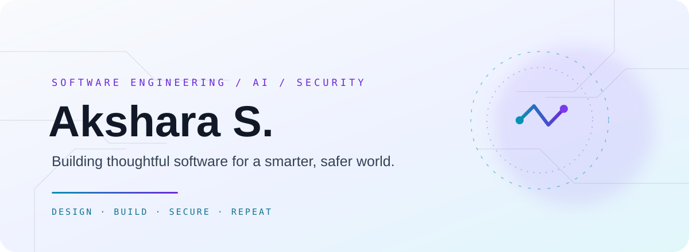

<!--
  AKSHARA S. | DEVELOPER PORTFOLIO
  GitHub automatically selects light/dark artwork using the viewer's appearance preference.
-->

<picture>
  <source media="(prefers-color-scheme: dark)" srcset="https://raw.githubusercontent.com/akshhwhatnow/akshhwhatnow/main/assets/portfolio-dark.svg">
  
</picture>

 

 

 

## About

I'm **Akshara** — a developer interested in the craft behind useful, reliable software. I enjoy moving between backend systems, product interfaces, AI workflows and security engineering.

My favourite work sits where **good engineering meets real-world problems**: protecting data, making systems observable, automating repetitive work and turning ambitious ideas into usable products.

|  |  |  |
|:---:|:---:|:---:|
| Backend & product engineering | Application & supply-chain security | AI, RAG & intelligent systems |

---

## Selected work

A few things I've been designing, engineering and experimenting with.

<table>
<tr>
<td width="50%" valign="top">

### LedgerGuard
FINTECH · FRAUD DETECTION

A payment ledger built around double-entry transactions, reconciliation and SQL-powered fraud-ring detection.

**Stack** · Python / PostgreSQL / React

</td>
<td width="50%" valign="top">

### DepGuard
SECURITY · DEVELOPER TOOLING

A GitHub-based supply-chain scanner for vulnerable dependencies, suspicious packages and actionable security recommendations.

**Stack** · Python / FastAPI / React

</td>
</tr>
<tr>
<td width="50%" valign="top">

### VaultRAG
GENERATIVE AI · DATA PRIVACY

A secure document-search experience with permission-aware retrieval, hybrid search and answers grounded in citations.

**Stack** · Python / FastAPI / PostgreSQL / Next.js

</td>
<td width="50%" valign="top">

### Orchestrix
DISTRIBUTED SYSTEMS · AUTOMATION

A job queue and workflow engine for task scheduling, execution tracking, retries and dependable background processing.

**Stack** · Go / PostgreSQL / React

</td>
</tr>
<tr>
<td width="50%" valign="top">

### Tarpit
CYBERSECURITY · THREAT INTELLIGENCE

A honeypot and monitoring project for capturing suspicious network activity, studying attacker behaviour and visualising threats.

**Stack** · Python / PostgreSQL / React / ML

</td>
<td width="50%" valign="top">

### Budget Tracker
WEB DEVELOPMENT · PRODUCT DESIGN

A personal-finance application for tracking income and expenses, with an interface prototyped in Figma.

**Stack** · HTML / CSS / JavaScript / Figma

</td>
</tr>
</table>

---

## The toolkit

<picture>
  <source media="(prefers-color-scheme: dark)" srcset="https://skillicons.dev/icons?i=python,c,cpp,go,js,html,css,react,nextjs,fastapi,postgres,docker,git,github,linux,figma&theme=dark&perline=8">
  
</picture>

Also exploring: REST APIs · JWT/OAuth · RBAC · RAG · LLM evaluation · pytest · GitHub Actions · Prometheus · Grafana · data analytics.

---

## Beyond the code

### Hackathons & challenges

- **Smart India Hackathon 2026** — Decentralized identity management and privacy-preserving authentication using Zero-Knowledge Proofs.
- **ISRO Bharatiya Antariksh Hackathon 2026** — AI/ML-based identification of tropical cloud clusters using INSAT satellite data.
- **eMudhra Hackathon 2026** — Represented Mount Carmel University in a technology-focused hackathon.
- **International 24-Hour Hackathon, Christ University** — *Ecocrisis Command*, a multi-agent AI concept for disaster response, agricultural protection and wildlife conservation.
- **Yugastr IT Hackathon** — Student-centric academic notes-sharing platform.
- **HackSphere '24** — Presented *Time Machine for Subject Exploration* at a state-level tech showcase.
- **National Conference on Trends in Multidisciplinary Research** — Oral presentation on applications of mathematics in cybersecurity.

### Certifications & professional learning

Credentials and learning experiences listed from my resume.

| Organisation | Certification / programme |
|:--|:--|
| IIT Madras | Cyber Security and Privacy |
| Google | Foundations of Project Management |
| Goldman Sachs | Software Engineering / IT Security job simulation |
| Deloitte | Cybersecurity job simulation |
| BCG | Customer churn prediction with Python and Random Forest |
| AIG | Cybersecurity and Python-based security exercise |
| ANZ | Cybersecurity job simulation |
| Accenture | Social media data analytics |
| City of Moreton Bay | HTML and CSS landing-page project |
| Y Combinator | Logistics startup Kanban task-management project |

### Education

- **MCA** — Mount Carmel (Deemed to be University) · 2025–2027 · Pursuing
- **B.Sc. Computer Science & Mathematics** — MS Ramaiah College of Arts, Science and Commerce · 2022–2025 · CGPA 8.91
- **PUC** — K.L.E. Society's S. Nijalingappa Independent PU College · 76.5%
- **SSLC** — Assumption English High School · 88.64%

### Next-level certification goals

Aspirational learning roadmap — **not claimed as completed**:

- AWS Certified Developer – Associate
- ISC2 Certified in Cybersecurity (CC)
- GitHub Foundations
- Microsoft Azure AI Fundamentals

---

## GitHub activity

<picture>
  <source media="(prefers-color-scheme: dark)" srcset="https://github-readme-stats.vercel.app/api?username=akshhwhatnow&show_icons=true&hide_border=true&theme=github_dark&rank_icon=github">
  
</picture>
<picture>
  <source media="(prefers-color-scheme: dark)" srcset="https://github-readme-stats.vercel.app/api/top-langs/?username=akshhwhatnow&layout=compact&hide_border=true&theme=github_dark">
  
</picture>

<picture>
  <source media="(prefers-color-scheme: dark)" srcset="https://streak-stats.demolab.com?user=akshhwhatnow&hide_border=true&theme=github-dark-blue">
  
</picture>

<picture>
  <source media="(prefers-color-scheme: dark)" srcset="https://github-readme-activity-graph.vercel.app/graph?username=akshhwhatnow&theme=github-compact&hide_border=true">
  
</picture>

---

### Let's build something meaningful.

Open to interesting conversations, collaborations and ambitious ideas.

Made with curiosity, care and a terminal that is probably still open.

