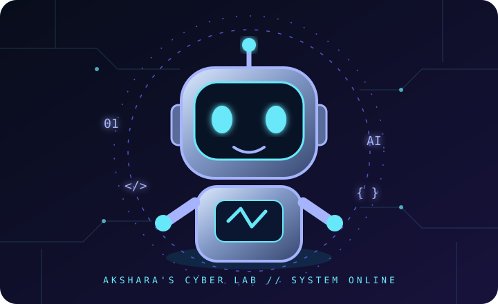

<!-- CYBER LAB PROFILE -->

<table>
<tr>
<td width="48%" valign="middle">

### 🤖 Meet my coding companion

**A tiny robot. A giant list of things to build.**

I'm Akshara — I turn coffee, curiosity and questionable amounts of debugging into software.

Exploring the intersection of:
- AI and intelligent systems
- Cybersecurity and privacy
- Backend and distributed systems
- Full-stack product building

</td>
<td width="52%" align="center" valign="middle">

</td>
</tr>
</table>

---

### ◈ THE LAB // LIVE SYSTEMS

---

### 🧪 Experiments in progress

<table>
<tr>
<td width="50%" valign="top">

**01 / LEDGERGUARD**

FRAUD DETECTION

A payment ledger that thinks twice. Double-entry transactions, reconciliation and fraud-ring detection.

</td>
<td width="50%" valign="top">

**02 / DEPGUARD**

SUPPLY CHAIN SECURITY

Hunting vulnerable dependencies and suspicious packages before they become problems.

</td>
</tr>
<tr>
<td width="50%" valign="top">

**03 / VAULTRAG**

PRIVATE AI SEARCH

A secure document brain: permission-aware retrieval, hybrid search and cited AI answers.

</td>
<td width="50%" valign="top">

**04 / ORCHESTRIX**

DISTRIBUTED SYSTEMS

A workflow engine for scheduling jobs, tracking execution and retrying failed tasks.

</td>
</tr>
<tr>
<td width="50%" valign="top">

**05 / TARPIT**

THREAT INTELLIGENCE

A honeypot and monitoring playground for capturing suspicious activity and visualizing threats.

</td>
<td width="50%" valign="top">

**06 / NEXT EXPERIMENT**

IDEAS → PROTOTYPES

Always making room for the next weird idea, useful tool or ambitious side quest.

</td>
</tr>
</table>

---

### 📡 GITHUB // TELEMETRY

---

### ⌁ CONNECT TO THE LAB

  
「 stay curious · build boldly · secure everything 」

