  

  

<h2 align="center">✦ A LITTLE ABOUT THE HUMAN BEHIND THE COMMITS ✦</h2>

  

  I'm Akshara — a developer drawn to the interesting overlap between <b>security, databases and AI</b>.
  I like software that does something useful: catching fraud rings with SQL, spotting sketchy dependencies,
  or making an AI show its sources instead of just sounding confident.

  <i>Part engineer, part curious experimenter, part person who will absolutely open Figma at an unreasonable hour.</i>

| CURRENTLY IN MY LAB | CURIOSITY QUEUE | ALWAYS UP FOR |
|:---:|:---:|:---:|
| LedgerGuard 💳 | Go concurrency | Interesting problems |
| Fraud patterns & SQL | RAG evaluation | Hackathon chaos |
| Safer software | Supply-chain security | Building with good people |

  

<h2 align="center">✦ THINGS THAT ESCAPED MY NOTEBOOK ✦</h2>

<i>Six experiments, six rabbit holes, plenty of late-night commits.</i>

<table>
<tr>
<td width="50%" valign="top">
  
  <h3>01 / LedgerGuard 💳</h3>
  <b>Money moves. Fraud leaves footprints.</b>
  
A payment ledger with double-entry transactions, reconciliation and SQL-powered fraud-ring detection.

  PYTHON · POSTGRESQL · REACT 
  <a href="https://github.com/akshhwhatnow/LedgerGuard">↗ ENTER THE REPO</a>
</td>
<td width="50%" valign="top">
  
  <h3>02 / DepGuard 📦</h3>
  <b>Your dependencies need a bouncer.</b>
  
Scans GitHub repositories for vulnerable or suspicious packages and suggests automated fixes.

  PYTHON · FASTAPI · REACT 
  <a href="https://github.com/akshhwhatnow/DepGuard">↗ ENTER THE REPO</a>
</td>
</tr>
<tr>
<td width="50%" valign="top">
  
  <h3>03 / VaultRAG 🔐</h3>
  <b>AI search. Receipts included.</b>
  
Permission-aware document retrieval with hybrid search and answers backed by citations.

  PYTHON · FASTAPI · POSTGRESQL · NEXT.JS 
  <a href="https://github.com/akshhwhatnow/VaultRAG">↗ ENTER THE REPO</a>
</td>
<td width="50%" valign="top">
  
  <h3>04 / Orchestrix ⚙️</h3>
  <b>Make distributed work feel less chaotic.</b>
  
A Go-based workflow engine with scheduling, automatic retries and job tracking.

  GO · POSTGRESQL · REACT 
  <a href="https://github.com/akshhwhatnow/Orchestrix">↗ ENTER THE REPO</a>
</td>
</tr>
<tr>
<td width="50%" valign="top">
  
  <h3>05 / Tarpit 🍯</h3>
  <b>Let the suspicious visitors tell on themselves.</b>
  
A honeypot that captures suspicious network activity, analyses attacker behaviour with ML and visualises threats.

  PYTHON · POSTGRESQL · REACT · ML 
  <a href="https://github.com/akshhwhatnow/Tarpit">↗ ENTER THE REPO</a>
</td>
<td width="50%" valign="top">
  
  <h3>06 / Budget Tracker 💰</h3>
  <b>My first little corner of the interface universe.</b>
  
Real-time income and expense tracking, prototyped in Figma before a line of code.

  HTML · CSS · JAVASCRIPT · FIGMA 
  <a href="https://github.com/akshhwhatnow/budget-tracker">↗ ENTER THE REPO</a>
</td>
</tr>
</table>

  

<h2 align="center">✦ THE HACKATHON MULTIVERSE ✦</h2>

<i>Sleep schedules were temporary. The ideas were not.</i>

| SIGNAL | MISSION / SIDE QUEST |
|:---:|---|
| 🌍 | **International 24-Hour Hackathon, Christ University** — EcoCrisis Command: multi-agent AI for compound disaster response, crop protection and wildlife conservation |
| 🆔 | **Smart India Hackathon 2026** — Decentralized identity with zero-knowledge proofs: prove who you are without revealing everything |
| 🛰️ | **ISRO Bharatiya Antariksh Hackathon 2026** — AI/ML to spot tropical cloud clusters from half-hourly INSAT satellite data |
| 🔏 | **eMudhra Hackathon 2026** — Represented Mount Carmel on a technology-for-impact problem |
| 📚 | **Yugastr IT Hackathon** — A one-stop platform for sharing and finding academic notes |
| 💡 | **HackSphere '24** — Pitched “Time Machine for Subject Exploration” |
| 🎤 | **National Conference on Multidisciplinary Research** — Talk: *Applications of Mathematics in Cybersecurity* |
| 🎬 | **Intercollegiate IT Fest 2023** — 🥈 2nd place, Short Film Making |

  

<h2 align="center">✦ MY DIGITAL TOOLBELT ✦</h2>

<i>Tools are just instruments. The fun is in what you make with them.</i>

**I SPEAK**
 

**I BUILD WITH**
 

**I STORE, SHIP & OBSERVE WITH**
 

**I'M AT HOME IN**
 

  <code>REST APIs</code> · <code>JWT / OAuth</code> · <code>RBAC</code> · <code>Window Functions</code> · <code>Recursive CTEs</code> · <code>Triggers</code> · <code>RAG</code> · <code>LLM Evaluation</code> · <code>Hybrid Search</code> · <code>Data Analytics</code> · <code>Secure Coding</code> · <code>Supply-Chain Security</code> · <code>pytest</code> · <code>Tally</code> · <code>Zoho Books</code> · <code>Excel</code> · <code>PowerPoint</code>

  

<h2 align="center">✦ KNOWLEDGE PICKED UP ALONG THE WAY ✦</h2>

<i>Workshops, simulations, experiments and a few very useful rabbit holes.</i>

<b>↳ Open the learning archive</b>

 

| WHO / WHERE | THE THING I EXPLORED | WHEN |
|---|---|---|
| **Y Combinator** | Built a Kanban task system for a logistics startup with a Node.js backend and SQL-driven product insights | Nov 2026 |
| **IIT Madras** | Cyber Security and Privacy | Jul–Oct 2026 |
| **Google** | Foundations of Project Management | Sep 2026 |
| **Goldman Sachs** | Assessed IT security, cracked weak passwords, proposed fixes | Feb 2025 |
| **Deloitte** | Analysed web logs during a simulated breach investigation | Feb 2025 |
| **BCG** | Churn prediction with a random forest (85% accuracy) | Jan 2025 |
| **AIG** | CISA vulnerability research and Python brute-force decryption | Dec 2024 |
| **City of Moreton Bay** | Planned a site and built an HTML/CSS landing page | Dec 2024 |
| **ANZ** | Flagged suspicious emails and inspected packet captures | Dec 2024 |
| **Accenture** | Social media trend analysis, presented in PowerPoint | Nov 2024 |

  

<h2 align="center">✦ THE COMMIT TRAIL ✦</h2>

  

**THE CONTRIBUTION CREATURE**
 

  

<h2 align="center">✦ WHEN I'M NOT STARING AT A TERMINAL ✦</h2>

📸 **Photography** &nbsp; ✦ &nbsp; 📖 **Reading** &nbsp; ✦ &nbsp; 🤝 **Volunteering**

🎨 **UI/UX & Figma** &nbsp; ✦ &nbsp; 🎬 **Short films** &nbsp; ✦ &nbsp; 🏃‍♀️ **Track events**

✍️ **Debates & creative writing**

 

<h2>✦ GOT A GOOD RABBIT HOLE? ✦</h2>

&nbsp;

